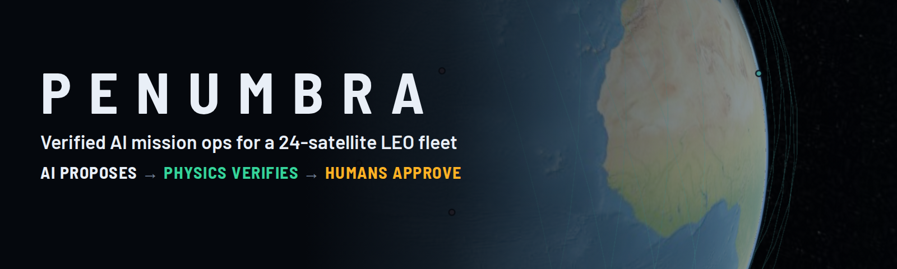
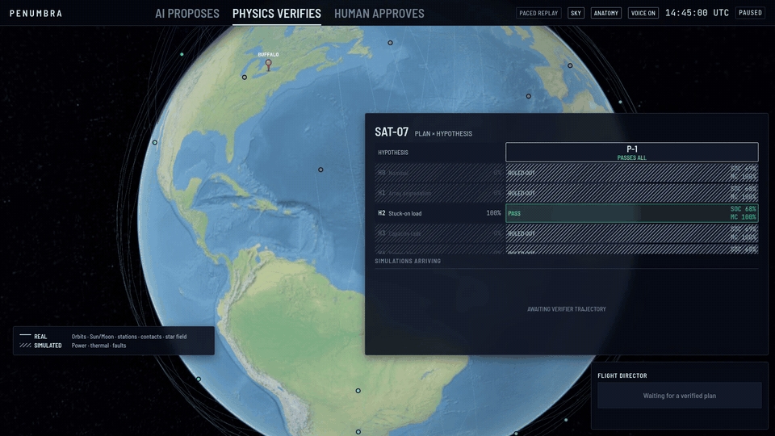
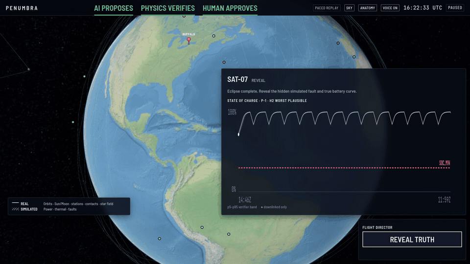
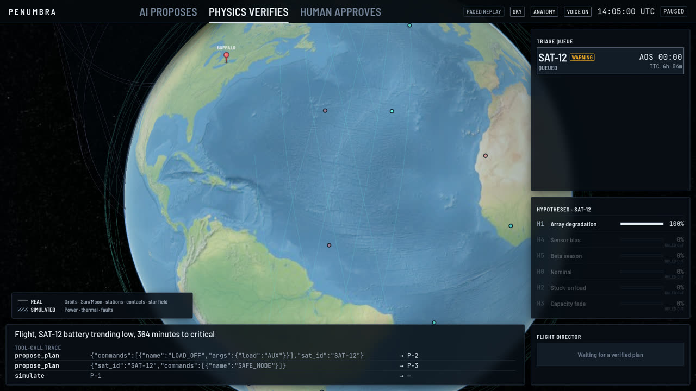
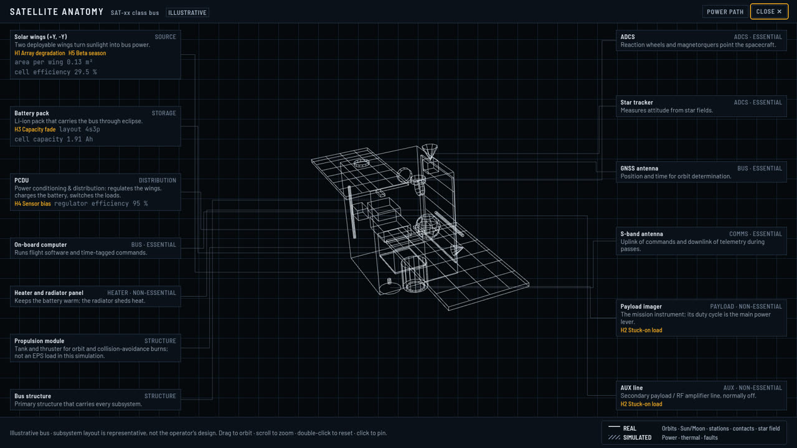

<p align="center"></p>

<p align="center">
  <a href="https://www.youtube.com/watch?v=QapdEbnx69w"><b>Demo video (2:38)</b></a> ·
  <a href="https://bullsinorbit.study/"><b>Live demo</b></a> ·
  Built at UB Hacking 2026
</p>

A satellite in low Earth orbit spends part of every orbit in Earth's shadow, running on its battery. If its power system fails there, operators may not hear about it until the next ground pass, and that pass gives them a few minutes to send the right command.

Penumbra is mission ops for that moment. A Gemini agent reads the fleet and proposes recovery plans, and a physics simulator checks every plan against every plausible cause before anyone can act on it. A human then approves the exact plan that passed. Nobody can approve a plan that failed verification, the AI included.

<p align="center"></p>

## Try it
Open [bullsinorbit.study](https://bullsinorbit.study/) and press **FAULT STORM**. Three satellites start failing. SAT-12 is fixed under a pre-approved flight rule, SAT-07 waits for your approval, and SAT-19 has no plan that survives every cause. Then the clock skips through the eclipse and the app reveals the fault it injected. The public demo replays a recorded live Gemini run at a fixed pace, so every visitor sees the same thing.

## How it works
<p align="center"></p>

- **Sense.** Detection and triage rank alerts by time to critical and show a countdown to each satellite's next pass.
- **Understand.** The Gemini agent calls tools (`get_fleet_status`, `score_hypotheses`, `propose_plan`, `simulate`) and keeps every plausible cause open. A safety layer rejects any command that is off the allowlist, switches off an essential load, falls outside a contact window, or carries a stale plan hash.
- **Act.** A Monte Carlo verifier runs each plan against each hypothesis through the next eclipse. Tier 1 plans run under a flight rule. Tier 2 plans need a human to approve the exact plan hash. If no plan passes, Penumbra recommends safe mode. An uplink scheduler (CP-SAT) fits the commands into real contact windows.

<p align="center"></p>

## Real vs simulated
| Real | Simulated |
|---|---|
| Satellite orbits (public OMM elements, renamed `SAT-01`..`SAT-24`) | All power-system telemetry |
| Sun and Earth geometry (JPL DE421) | Faults and sensor noise |
| Ground station locations and contact windows | Battery behavior (parameters fit to NASA PCoE battery data) |

No real satellite's telemetry appears anywhere. The UI always shows a Real / Simulated legend, and every results file lists which inputs are which.

## Results (measured offline)
- Diagnosis (B2, n = 40 seeded simulated cases): the scorer ranks the true cause first in 36 of 40 cases with peer and diagnostic evidence, and in 31 of 40 with neither. [`bench/results/b2.json`](bench/results/b2.json)
- Scale (B4): checking 24 satellites × 6 hypotheses × 3 plans × 20 Monte Carlo draws over 3 hours takes 49 ms on a 22-CPU laptop and 227 ms on a 2-vCPU Vultr instance. The same check for 10,000 satellites takes 29 s and 84 s. Scheduling 200 uplinks with CP-SAT (optimal) takes 0.28 s and 1.5 s. [`b4.json`](bench/results/b4.json), [`b4_vultr.json`](bench/results/b4_vultr.json)

| Agent trace and triage | Satellite anatomy and power path |
|---|---|
|  |  |

## Built with
- **Gemini:** the agent runs on function calling, and push-to-talk voice commands are transcribed to text.
- **ElevenLabs:** spoken callouts for alerts and decisions, cached so the demo also runs offline.
- **Vultr:** hosts the public replay demo and ran the B4 scale benchmark.
- Python (FastAPI, Skyfield, NumPy, OR-Tools CP-SAT) and a Cesium + Vite frontend.

## Run it locally
```bash
python3.11 -m venv .venv && . .venv/bin/activate
pip install -r backend/requirements.txt
npm --prefix frontend ci && npm --prefix frontend run build
PENUMBRA_OFFLINE=1 PENUMBRA_REPLAY=runs/demo/live-fault-storm.jsonl PENUMBRA_REPLAY_PACE_MS=700 \
  PENUMBRA_STATIC_DIR=frontend/dist uvicorn backend.api.app:app --port 8000
```
Open http://localhost:8000. Run the tests with `PENUMBRA_OFFLINE=1 python -m pytest -q`. Live mode reads `GEMINI_API_KEY`, `GEMINI_MODEL` and `ELEVENLABS_API_KEY` from the environment.

## Repository
| Path | What |
|---|---|
| `backend/orbit/` | Orbits, eclipse with penumbra, contact windows (Skyfield, offline data) |
| `backend/eps/` | Truth power simulator and seeded faults |
| `backend/verify/` | Planning model, Monte Carlo verifier, ranking |
| `backend/fleet/` | Detection, triage, tier policy, demo scenarios |
| `backend/agent/` | Gemini agent loop and safety layer |
| `backend/recorder/`, `backend/sched/` | Flight recorder and replay, uplink scheduler |
| `backend/api/`, `frontend/` | FastAPI + WebSocket server, Cesium UI |
| `bench/`, `tests/` | Benchmarks, end-to-end tests |
| `contracts/`, `CONTRACTS.md` | Frozen interface spec shared by all modules |

## Team
Team Penumbra at UB Hacking 2026: [Nguyen-Le-Tuan](https://github.com/Nguyen-Le-Tuan) and [Anh-08](https://github.com/Anh-08). All product code was written during the hacking period; [docs/PRE-EVENT.md](docs/PRE-EVENT.md) lists what existed before it.
